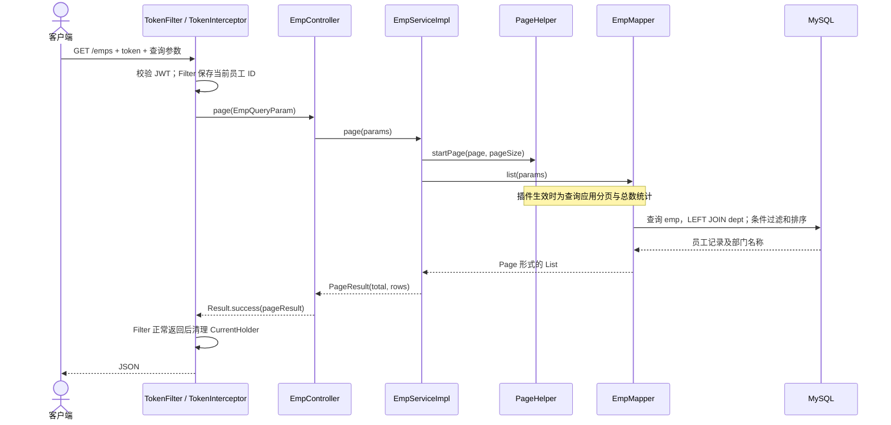
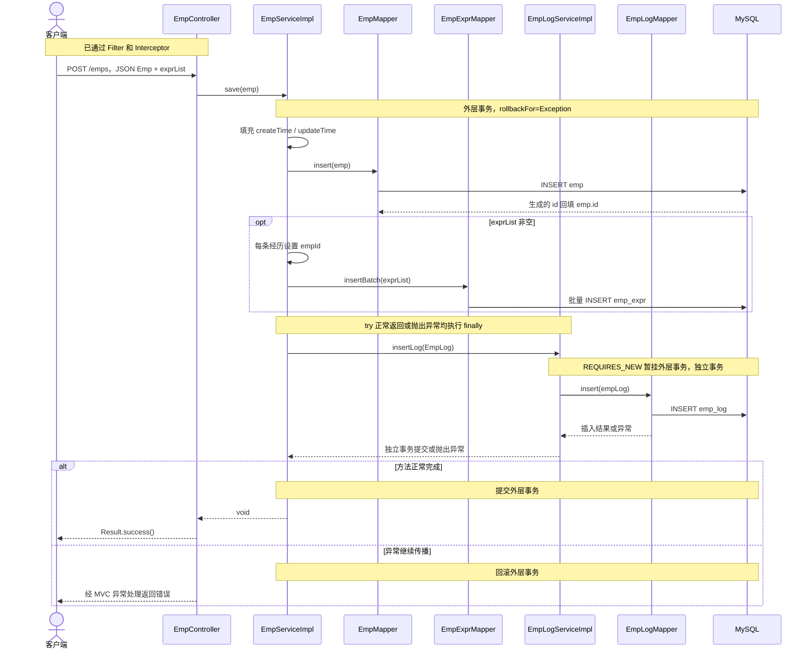
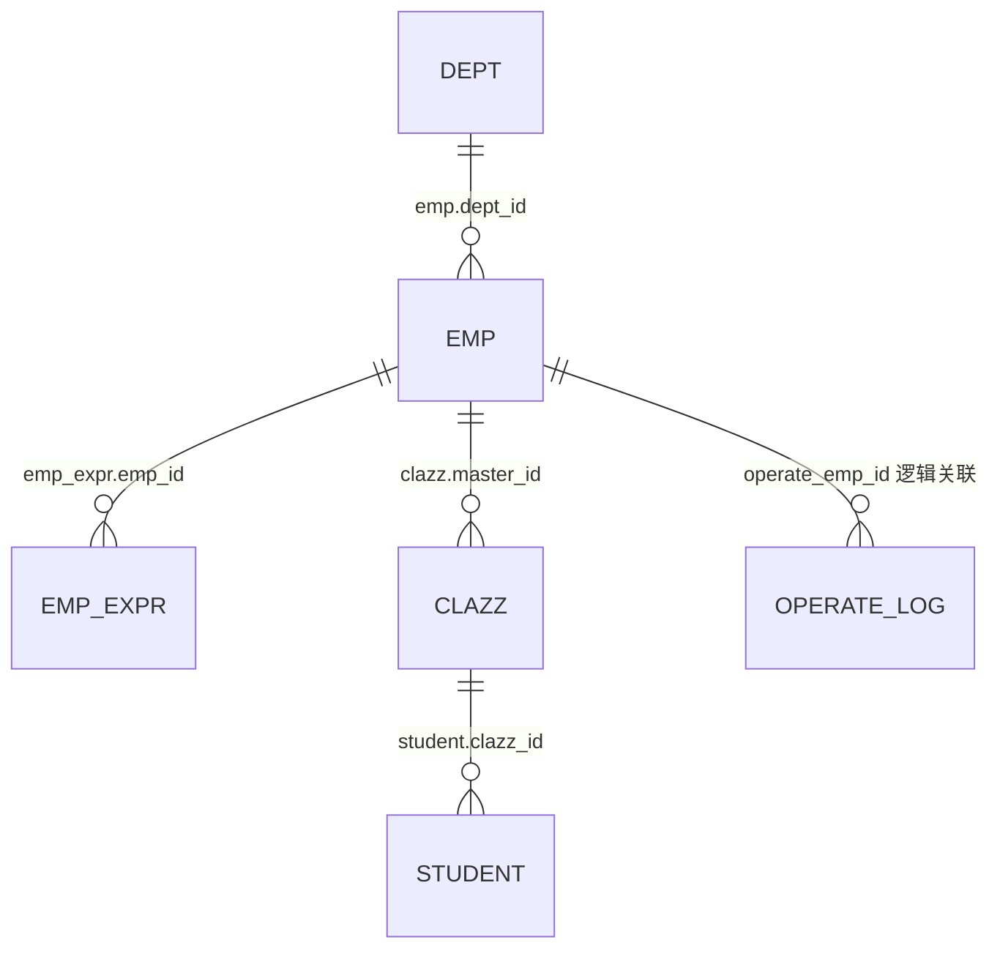
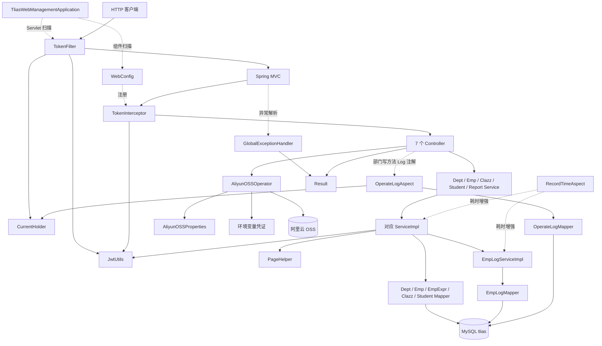
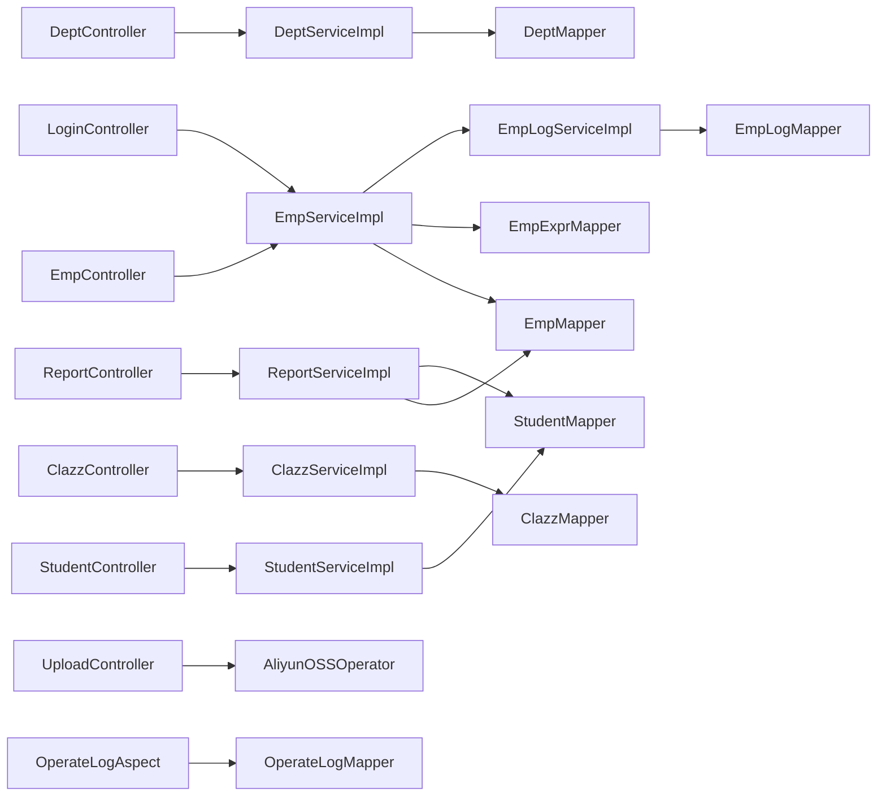

# 项目结构说明书

分析日期：2026-09-26。分析根目录：`D:/DocumantFiles/CodeSet/springboot-full-stack-project-demo`。

本说明书只依据该目录的现有源码、构建文件和资源文件进行静态分析；没有使用外部项目资料，没有启动应用、执行测试或连接数据库、OSS。除新增本说明书外，不修改源码、配置和已有构建产物。

覆盖范围：1 个 Maven 应用模块、55 个主源码 Java 类型（包括接口和注解）、4 个测试/示例 Java 类型、4 个 Mapper XML、29 个有效 Controller 接口。被注释掉的代码不计入有效接口。`target` 仅用于识别已有产物，不作为当前源码已通过构建或已部署的证明。

**依据约定**：类表中的文件链接指向完整源码路径；主源码表的路径显示相对于 `D:/DocumantFiles/CodeSet/springboot-full-stack-project-demo/tlias-web-management/src/main/java/com/itheima`。正文中的类名、方法名对应这些文件。配置和 XML 单独提供链接。“需确认”表示现有文件不能证明；基于框架惯例推导的运行行为也明确标注，不能视为实测结果。

## 1. 项目概览

### 1.1 项目定位与边界

这是一个名为 `tlias-web-management` 的教学管理类后端，提供部门、员工及工作经历、班级、学员、统计报表、员工登录和文件上传功能。业务定位由 Controller、实体及 SQL 共同推断；没有 README 提供正式产品定义。项目采用单体分层结构，所有功能在同一应用内，没有独立微服务或 Maven 子模块聚合声明。依据：[构建文件][pom]、第 4 节 Controller 和 Service。

根目录不是 Maven 聚合工程，实际 `pom.xml` 在应用目录内。源码只附带一个上传演示 HTML，不能由仓库名推断存在完整前端工程。

### 1.2 技术栈与声明的依赖

| 技术/组件 | 文件中声明的版本或方式 | 项目用途与依据 |
| --- | --- | --- |
| Java | 17 | `pom.xml` 的 `java.version`；使用 `java.time`、Stream 等 |
| Spring Boot | 3.5.14 | POM 父工程；启动、自动配置、依赖管理 |
| Spring MVC | `spring-boot-starter-web`，未单独指定版本 | REST 接口、JSON 转换、参数绑定、Multipart 上传 |
| Maven | 有 POM，无 Wrapper；Maven 自身版本需确认 | 单模块构建；Boot 插件打包；Compiler 插件配置 Lombok 注解处理器 |
| MyBatis | Starter 3.0.5 | `@Mapper` 代理、注解 SQL 与 XML 动态 SQL |
| MySQL JDBC | `mysql-connector-j`，runtime，版本交由父工程管理 | 连接 MySQL；无法从驱动依赖推断 MySQL 服务端版本 |
| PageHelper | Starter 1.4.7 | 员工、班级、学员分页；Service 中调用 `startPage` |
| Spring AOP/事务 | AOP Starter；事务注解 | Service 耗时、部门操作审计、员工聚合写入事务 |
| JWT | `io.jsonwebtoken:jjwt:0.9.1` | HS256 签名及校验；源码固定有效期 12 小时 |
| 阿里云 OSS | SDK 3.18.4 | 上传文件至对象存储，使用环境变量凭证和 V4 签名 |
| JAXB/Activation | API 2.3.1、Runtime 2.3.3、Activation 1.1.1 | POM 明确引入的兼容依赖；源码无直接业务调用，具体传递调用需依赖分析确认 |
| Lombok | 未单独指定版本；optional | `@Data`、构造器、`@Slf4j`；打包插件排除 Lombok |
| SLF4J / Logback | 源码日志 API 和 `logback.xml` | 控制台及滚动文件日志 |
| 测试 | Boot Test；MyBatis Test Starter 3.0.5；JUnit Jupiter 注解 | 上下文加载及日志、JWT 示例 |

以上是 POM 声明值，不是实时依赖解析结果；尤其不能据此保证 PageHelper 等组合在当前环境可启动。依据：[pom.xml][pom]、[JwtUtils][JwtUtils]、[AliyunOSSOperator][AliyunOSSOperator]、[logback.xml][logback]。

### 1.3 运行方式与前置条件

源码入口为 [TliasWebManagementApplication.main][TliasWebManagementApplication]。根据 POM 和 Boot 插件，可推导以下常规操作方式；本次没有执行：

```powershell
Set-Location 'D:\DocumantFiles\CodeSet\springboot-full-stack-project-demo\tlias-web-management'
mvn spring-boot:run
```

也可在 IDE 中运行该入口类。构建命令为 `mvn package`；POM 没有配置 `finalName`，按 Maven 默认命名推导，新产物应为 `target/tlias-web-management-0.0.1-SNAPSHOT.jar`，可使用 `java -jar` 启动。现有 `target` 中实际有 `tlias-web-management.jar`、`tlias.jar` 和 `.jar.original`，其重命名过程、构建来源及与源码的一致性均需确认，不能混用为同一构建结论。

运行需准备：JDK 17、可用 Maven 和依赖仓库、可解析主机名 `mysql` 的 MySQL 服务、`tlias` 数据库及所需表、配置中的有效数据库凭证。上传还需要 `OSS_ACCESS_KEY_ID`、`OSS_ACCESS_KEY_SECRET` 以及有权限访问的 Bucket。日志输出路径需要可写。

配置未声明 `server.port` 和 context path；**按 Boot 默认行为推导**为端口 8080、无额外上下文前缀，但命令行参数和外部配置可能覆盖，实际地址需启动日志或部署配置确认。没有发现环境 Profile 文件、Dockerfile、Compose、启动脚本、DDL 或迁移文件。

### 1.4 分层结构

请求进入 Servlet Filter，再进入 Spring MVC 拦截器及 Controller；Controller 委托 Service 接口，Service 实现调用 MyBatis Mapper，Mapper 通过 SQL 访问 MySQL。POJO 同时承担实体、请求参数和响应对象角色，没有独立 DTO/VO/领域模块。上传由 Controller 直接调用 OSS 工具；操作审计由 AOP 直接调用日志 Mapper。依据：第 4 节各类型及第 10 节依赖图。

## 2. 目录树注释

下列树完整覆盖源码目录和业务资源文件；Java 文件逐一见第 4 节。`.git`、IDE 元数据及构建目录按职责归并，不展开其内部实现文件。

```text
springboot-full-stack-project-demo/
├── .git/                              Git 元数据，不参与应用运行
├── .idea/                             IDEA 工程、编码、编译器、仓库及本机工作区设置
├── springboot-full-stack-project-demo.iml  IDEA 根工程模块描述
├── PROJECT_STRUCTURE.md               本次新增的结构说明书
└── tlias-web-management/               唯一后端 Maven 应用
    ├── pom.xml                        依赖、Java 版本、编译和打包插件
    ├── src/                           源码与资源根目录
    │   ├── main/                      生产应用内容
    │   │   ├── java/                  Java 源码根
    │   │   │   └── com/itheima/        包命名空间；含应用启动类
    │   │   │       ├── anno/          1 个操作日志标记注解
    │   │   │       ├── aop/           2 个切面：操作审计、Service 耗时
    │   │   │       ├── config/        1 个 MVC 拦截器注册配置
    │   │   │       ├── controller/    7 个 REST Controller
    │   │   │       ├── exception/     1 个全局 MVC 异常处理器
    │   │   │       ├── filter/        2 个 Servlet Filter；只有 TokenFilter 启用
    │   │   │       ├── interceptor/   2 个 MVC 拦截器；只有 TokenInterceptor 注册
    │   │   │       ├── mapper/        7 个 MyBatis DAO 接口
    │   │   │       ├── pojo/          15 个实体、查询参数和响应类型
    │   │   │       ├── service/       6 个业务接口
    │   │   │       │   └── impl/      6 个业务实现
    │   │   │       └── utils/         JWT、当前用户、OSS 上传与配置绑定
    │   │   └── resources/             配置、MyBatis XML、静态资源
    │   │       ├── application.yml    数据源、上传限制、MyBatis、日志、OSS 配置
    │   │       ├── logback.xml        控制台和滚动文件日志配置
    │   │       ├── com/itheima/mapper/ 与 Mapper 接口同包路径的 XML 资源
    │   │       │   ├── ClazzMapper.xml   班级分页、详情、动态修改
    │   │       │   ├── EmpMapper.xml     员工查询、经历映射、批删、修改及报表
    │   │       │   ├── EmpExprMapper.xml 工作经历批量插入与删除
    │   │       │   └── StudentMapper.xml 学员 CRUD 动态 SQL 及报表
    │   │       └── static/
    │   │           └── upload.html    上传表单演示，无 token 请求头处理
    │   └── test/java/com/itheima/      测试源码包
    │       ├── TliasWebManagementApplicationTests.java  上下文加载测试
    │       ├── JwtTest.java           JWT 生成/解析示例测试
    │       ├── LogTest.java           日志示例测试
    │       └── Demo.java              OSS 上传 main 示例，不是 JUnit 测试
    └── target/                        已有构建产物；本次未重建
        ├── classes/                   主源码 class 及资源副本，同名包与 static 目录
        ├── test-classes/              测试源码编译结果
        ├── generated-sources/annotations/       主源码注解处理输出目录
        ├── generated-test-sources/test-annotations/ 测试注解处理输出目录
        ├── maven-archiver/            pom.properties 等打包元数据
        ├── maven-status/maven-compiler-plugin/
        │   ├── compile/default-compile/         主源码编译输入/输出清单
        │   └── testCompile/default-testCompile/ 测试编译输入/输出清单
        ├── tlias-web-management-0.0.1-SNAPSHOT.jar.original
        ├── tlias-web-management.jar
        └── tlias.jar
```

`target/classes` 里的配置和 XML 是资源副本，不是另一套正式环境配置。仓库实际跟踪了多项 `target` 产物；本说明书以 `src` 为行为依据。

## 3. 模块与包说明

### 3.1 业务模块（逻辑划分，不是独立 Maven 模块）

| 模块 | 职责与关键类 | 依赖 | 被谁依赖 |
| --- | --- | --- | --- |
| 部门 | DeptController / DeptServiceImpl / DeptMapper；部门 CRUD | `dept`；写接口触发 `@Log` | 员工分页 SQL 联查部门名称 |
| 员工与经历 | EmpController / EmpServiceImpl / EmpMapper / EmpExprMapper；员工 CRUD、经历聚合 | `emp`、`emp_expr`、`dept`、EmpLogService | 登录、员工统计、班主任候选列表及班级联查 |
| 班级 | ClazzController / ClazzServiceImpl / ClazzMapper | `clazz`，联查 `emp` 班主任 | 学员列表、班级人数统计 |
| 学员 | StudentController / StudentServiceImpl / StudentMapper；CRUD、违纪处理 | `student`、`clazz` | 学员统计报表 |
| 报表 | ReportController / ReportServiceImpl | 直接复用 EmpMapper、StudentMapper | HTTP 客户端；没有独立报表表 |
| 登录和认证 | LoginController、EmpServiceImpl.login、JwtUtils、TokenFilter、TokenInterceptor | 员工账号、JWT、CurrentHolder | 除登录放行路径外的请求；审计读取当前员工 ID |
| 上传 | UploadController、AliyunOSSOperator、AliyunOSSProperties | OSS SDK、环境变量、OSS 配置 | HTTP 文件上传；现有业务实体仅保存 image 字符串，无源码证据证明自动关联 |
| 日志 | EmpLogServiceImpl、OperateLogAspect、RecordTimeAspect | `emp_log`、`operate_log`、SLF4J | 员工新增、部门增删改、Service 调用 |

### 3.2 包依赖

| 包路径 | 职责 / 关键类型 | 直接依赖 | 被谁依赖或装配 |
| --- | --- | --- | --- |
| `com.itheima` | TliasWebManagementApplication | Spring Boot | JVM/启动器；扫描下级包 |
| `com.itheima.anno` | Log 方法标记 | Java 注解 API | DeptController、OperateLogAspect |
| `com.itheima.aop` | OperateLogAspect、RecordTimeAspect | AspectJ API、OperateLogMapper、CurrentHolder | Spring AOP；Controller/Service 代理调用 |
| `com.itheima.config` | WebConfig | TokenInterceptor、WebMvcConfigurer | Spring MVC 配置流程 |
| `com.itheima.controller` | 7 个请求入口 | service、pojo；上传额外依赖 utils | Spring MVC 请求分发 |
| `com.itheima.exception` | GlobalExceptionHandler | Result、DuplicateKeyException | MVC 异常解析机制 |
| `com.itheima.filter` | TokenFilter、DemoFilter | Servlet API、JwtUtils、CurrentHolder | Servlet 容器；DemoFilter 未注册 |
| `com.itheima.interceptor` | TokenInterceptor、DemoInterceptor | MVC API、JwtUtils | WebConfig 注册 TokenInterceptor；DemoInterceptor 仅是 Bean |
| `com.itheima.mapper` | 7 个 MyBatis 接口 | pojo、MyBatis、SQL/XML | service.impl；OperateLogAspect |
| `com.itheima.pojo` | 7 个表对应实体、3 个查询参数、5 个响应封装 | Lombok、Java 类型；查询参数依赖日期绑定注解 | Controller、Service、Mapper、AOP |
| `com.itheima.service` | 6 个业务契约 | pojo、集合类型 | Controller、实现类；EmpServiceImpl 依赖 EmpLogService |
| `com.itheima.service.impl` | 6 个业务实现 | service、mapper、pojo、PageHelper；员工登录依赖 JwtUtils | Controller 经接口调用；AOP 和事务代理 |
| `com.itheima.utils` | JwtUtils、CurrentHolder、AliyunOSSOperator、AliyunOSSProperties | JJWT、OSS SDK、配置绑定、ThreadLocal | 登录、认证、操作审计、上传 |

包依赖以实际字段注入和方法调用为准，不把未使用的 import 当作功能依赖。报表没有经员工/学员 Service 转发；工作经历没有独立 Controller/Service，由员工 Service 维护。

## 4. 类职责表

以下“调用方”限定为当前源码可见的直接调用或框架注册入口；不是运行时调用追踪。Lombok 生成的 getter/setter/toString/构造器统一记为“Lombok 访问方法”。

### 4.1 入口、配置与横切组件（13 个）

| 类名 | 路径 | 分层类型 | 职责、关键方法 | 依赖 | 被谁调用 / 状态 |
| --- | --- | --- | --- | --- | --- |
| TliasWebManagementApplication | [TliasWebManagementApplication.java][TliasWebManagementApplication] | Bootstrap | `main` 启动应用；启用组件和 Servlet 组件扫描 | SpringApplication | JVM/Boot 启动器 |
| Log | [anno/Log.java][Log] | Annotation | 无属性的运行时方法标记 | Target、Retention | DeptController 三个写方法；AOP 匹配 |
| OperateLogAspect | [aop/OperateLogAspect.java][OperateLogAspect] | AOP | `logOperate` 正常返回后保存方法审计；`getCurrentUserId` | OperateLogMapper、CurrentHolder | `@Log` 方法代理；目前为部门增删改 |
| RecordTimeAspect | [aop/RecordTimeAspect.java][RecordTimeAspect] | AOP | `recordTime` 统计 Service 方法正常返回的耗时 | ProceedingJoinPoint、SLF4J | `service.impl.*.*(..)` 的 Spring 代理调用 |
| WebConfig | [config/WebConfig.java][WebConfig] | Config | `addInterceptors` 注册 `/**` 拦截 | TokenInterceptor | Spring MVC |
| GlobalExceptionHandler | [exception/GlobalExceptionHandler.java][GlobalExceptionHandler] | Exception Handler | `handleException` 通用错误；`handleDuplicateKeyException` 提取重复值 | Result、DuplicateKeyException | MVC 异常处理；不等于 Servlet Filter 外层异常处理 |
| TokenFilter | [filter/TokenFilter.java][TokenFilter] | Filter | `doFilter` 登录放行、JWT 校验、保存/清理当前用户 | JwtUtils、CurrentHolder | `@WebFilter("/*")`，由 ServletComponentScan 启用 |
| DemoFilter | [filter/DemoFilter.java][DemoFilter] | Filter 示例 | `init`、`doFilter`、`destroy` 演示生命周期 | Servlet API、SLF4J | `@WebFilter` 被注释，未见其他注册 |
| TokenInterceptor | [interceptor/TokenInterceptor.java][TokenInterceptor] | Interceptor | `preHandle` 再次校验 token | JwtUtils | WebConfig 注册，实际启用 |
| DemoInterceptor | [interceptor/DemoInterceptor.java][DemoInterceptor] | Interceptor 示例 | `preHandle`、`postHandle`、`afterCompletion` | MVC API | 有 `@Component`，但未注册到 MVC 拦截链 |
| CurrentHolder | [utils/CurrentHolder.java][CurrentHolder] | Util | `setCurrentId`、`getCurrentId`、`remove` 封装 ThreadLocal | ThreadLocal<Integer> | TokenFilter 写入/清理；OperateLogAspect 读取 |
| JwtUtils | [utils/JwtUtils.java][JwtUtils] | Util | `generateToken`、`parseToken`；HS256、12 小时 | JJWT；源码固定密钥 | EmpServiceImpl、TokenFilter、TokenInterceptor |
| AliyunOSSProperties | [utils/AliyunOSSProperties.java][AliyunOSSProperties] | Config/POJO | 绑定 `aliyun.oss` 的 endpoint、bucketName、region；Lombok 访问方法 | ConfigurationProperties | Spring 配置绑定；AliyunOSSOperator 读取 |

### 4.2 Controller 与上传工具（8 个）

| 类名 | 路径 | 分层类型 | 职责、关键方法 | 依赖 | 被谁调用 |
| --- | --- | --- | --- | --- | --- |
| DeptController | [controller/DeptController.java][DeptController] | Controller | `list/delete/add/getInfo/update`；部门 CRUD | DeptService、Result、Dept、Log | MVC，5 个接口 |
| EmpController | [controller/EmpController.java][EmpController] | Controller | `page/save/delete/getInfo/update/findAll` | EmpService、EmpQueryParam、Emp、PageResult、Result | MVC，6 个接口 |
| ClazzController | [controller/ClazzController.java][ClazzController] | Controller | `page/deleteById/add/getInfo/update/findAll` | ClazzService、ClazzQueryParam、Clazz、PageResult、Result | MVC，6 个接口 |
| StudentController | [controller/StudentController.java][StudentController] | Controller | `page/deleteByIds/add/getInfo/update/violation` | StudentService、StudentQueryParam、Student、PageResult、Result | MVC，6 个接口 |
| ReportController | [controller/ReportController.java][ReportController] | Controller | `getEmpJobData/getEmpGenderData/studentCountData/studentDegreeData` | ReportService、统计响应对象、Result | MVC，4 个接口 |
| LoginController | [controller/LoginController.java][LoginController] | Controller | `login`，失败返回用户名或密码错误 | EmpService、Emp、LoginInfo、Result | MVC，1 个接口 |
| UploadController | [controller/UploadController.java][UploadController] | Controller | `upload` 接收 MultipartFile 并返回 URL | AliyunOSSOperator、Result | MVC，1 个有效接口；本地上传版本已注释 |
| AliyunOSSOperator | [utils/AliyunOSSOperator.java][AliyunOSSOperator] | Util/外部存储适配 | `upload` 按 yyyy/MM + UUID + 原后缀命名，上传后关闭客户端 | AliyunOSSProperties、OSS SDK、环境变量凭证 | UploadController |

### 4.3 Service 接口与实现（12 个）

| 类名 | 路径 | 分层类型 | 职责、关键方法 | 依赖 | 被谁调用 / 实现关系 |
| --- | --- | --- | --- | --- | --- |
| DeptService | [service/DeptService.java][DeptService] | Service 接口 | `findAll/deleteById/add/getById/update` | Dept | DeptController；DeptServiceImpl 实现 |
| DeptServiceImpl | [service/impl/DeptServiceImpl.java][DeptServiceImpl] | Service | 实现上述方法；新增/修改补齐时间 | DeptMapper、LocalDateTime | DeptController 经 DeptService |
| EmpService | [service/EmpService.java][EmpService] | Service 接口 | `page/save/delete/getInfo/update/findAll/login` | Emp、EmpQueryParam、PageResult、LoginInfo | EmpController、LoginController；EmpServiceImpl 实现 |
| EmpServiceImpl | [service/impl/EmpServiceImpl.java][EmpServiceImpl] | Service | 员工/经历事务维护、分页、登录签发 JWT；`update` 先删后插经历 | EmpMapper、EmpExprMapper、EmpLogService、PageHelper、JwtUtils | EmpController、LoginController 经 EmpService |
| EmpLogService | [service/EmpLogService.java][EmpLogService] | Service 接口 | `insertLog` 员工新增日志契约 | EmpLog | EmpServiceImpl；EmpLogServiceImpl 实现 |
| EmpLogServiceImpl | [service/impl/EmpLogServiceImpl.java][EmpLogServiceImpl] | Service | `insertLog` 使用 REQUIRES_NEW 独立事务 | EmpLogMapper | EmpServiceImpl.save 的 finally |
| ClazzService | [service/ClazzService.java][ClazzService] | Service 接口 | `page/delete/add/getInfo/update/findAll` | Clazz、ClazzQueryParam、PageResult | ClazzController；ClazzServiceImpl 实现 |
| ClazzServiceImpl | [service/impl/ClazzServiceImpl.java][ClazzServiceImpl] | Service | 实现班级 CRUD；分页时按日期计算状态 | ClazzMapper、PageHelper、LocalDate/LocalDateTime | ClazzController 经 ClazzService |
| StudentService | [service/StudentService.java][StudentService] | Service 接口 | `page/deleteByIds/add/getInfo/update/violation` | Student、StudentQueryParam、PageResult | StudentController；StudentServiceImpl 实现 |
| StudentServiceImpl | [service/impl/StudentServiceImpl.java][StudentServiceImpl] | Service | 学员 CRUD、分页、违纪处理；违纪次数使用类级静态变量 | StudentMapper、PageHelper、LocalDateTime | StudentController 经 StudentService |
| ReportService | [service/ReportService.java][ReportService] | Service 接口 | `getEmpJobData/getEmpGenderData/getstudentCountData/getStuDegreeData` | JobOption、StudentClazzsOption、List/Map | ReportController；ReportServiceImpl 实现 |
| ReportServiceImpl | [service/impl/ReportServiceImpl.java][ReportServiceImpl] | Service | 把 SQL 聚合结果整理为图表数组或 name/value 列表 | EmpMapper、StudentMapper | ReportController 经 ReportService |

### 4.4 Mapper（7 个）

| 类名 | 路径 | 分层类型 | 职责、关键方法 | 依赖 / 表 | 被谁调用 |
| --- | --- | --- | --- | --- | --- |
| DeptMapper | [mapper/DeptMapper.java][DeptMapper] | DAO | `findAll/deleteById/insert/getById/update`；全为注解 SQL | Dept；`dept` | DeptServiceImpl |
| EmpMapper | [mapper/EmpMapper.java][EmpMapper] | DAO | `list/insert/deleteByIds/getById/updateById/countEmpJobData/countEmpGenderData/selectAll/selectByUsernameAndPassword` | Emp、EmpQueryParam、[EmpMapper.xml][EmpMapperXML]；`emp/dept/emp_expr` | EmpServiceImpl、ReportServiceImpl |
| EmpExprMapper | [mapper/EmpExprMapper.java][EmpExprMapper] | DAO | `insertBatch/deleteByEmpIds` | EmpExpr、[EmpExprMapper.xml][EmpExprMapperXML]；`emp_expr` | EmpServiceImpl |
| EmpLogMapper | [mapper/EmpLogMapper.java][EmpLogMapper] | DAO | `insert` 新增员工操作信息 | EmpLog；`emp_log` | EmpLogServiceImpl |
| ClazzMapper | [mapper/ClazzMapper.java][ClazzMapper] | DAO | `list/delete/insert/getById/update/findAll` | Clazz、ClazzQueryParam、[ClazzMapper.xml][ClazzMapperXML]；`clazz/emp` | ClazzServiceImpl |
| StudentMapper | [mapper/StudentMapper.java][StudentMapper] | DAO | `list/deleteByIds/insert/getInfo/update/violation/countStuClazzsData/countStuDegreeData` | Student、StudentQueryParam、[StudentMapper.xml][StudentMapperXML]；`student/clazz` | StudentServiceImpl、ReportServiceImpl |
| OperateLogMapper | [mapper/OperateLogMapper.java][OperateLogMapper] | DAO | `insert` 保存操作人员、方法、参数、返回值、耗时 | OperateLog；`operate_log` | OperateLogAspect |

### 4.5 POJO（15 个）

| 类名 | 路径 | 分层类型 | 职责 / 关键方法 | 依赖 | 被谁使用 |
| --- | --- | --- | --- | --- | --- |
| Dept | [pojo/Dept.java][Dept] | Entity/请求响应 | 部门字段；Lombok 访问方法 | LocalDateTime | DeptController、DeptService/Impl、DeptMapper |
| Emp | [pojo/Emp.java][Emp] | Entity/请求响应 | 员工字段及 deptName、exprList；Lombok 访问方法 | LocalDate、LocalDateTime、List<EmpExpr> | Emp/LoginController、EmpService/Impl、EmpMapper |
| EmpExpr | [pojo/EmpExpr.java][EmpExpr] | Entity/嵌套请求响应 | 员工工作经历；Lombok 访问方法 | LocalDate | Emp.exprList、EmpServiceImpl、EmpExprMapper、EmpMapper 结果映射 |
| EmpLog | [pojo/EmpLog.java][EmpLog] | Entity | 员工新增操作信息；Lombok 访问方法 | LocalDateTime | EmpServiceImpl、EmpLogService/Impl、EmpLogMapper |
| Clazz | [pojo/Clazz.java][Clazz] | Entity/请求响应 | 班级、班主任名称、计算状态；Lombok 访问方法 | LocalDate、LocalDateTime | ClazzController、ClazzService/Impl、ClazzMapper |
| Student | [pojo/Student.java][Student] | Entity/请求响应 | 学员、班级名称、违纪信息；Lombok 访问方法 | LocalDate、LocalDateTime | StudentController、StudentService/Impl、StudentMapper |
| OperateLog | [pojo/OperateLog.java][OperateLog] | Entity | 通用方法操作日志；Lombok 访问方法 | LocalDateTime | OperateLogAspect、OperateLogMapper |
| EmpQueryParam | [pojo/EmpQueryParam.java][EmpQueryParam] | Query DTO | 员工姓名、性别、入职日期范围及分页；Lombok 访问方法 | LocalDate、DateTimeFormat | EmpController、EmpService/Impl、EmpMapper |
| ClazzQueryParam | [pojo/ClazzQueryParam.java][ClazzQueryParam] | Query DTO | 班名、结课日期范围及分页；Lombok 访问方法 | LocalDate、DateTimeFormat | ClazzController、ClazzService/Impl、ClazzMapper |
| StudentQueryParam | [pojo/StudentQueryParam.java][StudentQueryParam] | Query DTO | 姓名、学历、班级及分页；Lombok 访问方法 | String、Integer | StudentController、StudentService/Impl、StudentMapper |
| Result | [pojo/Result.java][Result] | Response | code/msg/data；`success()`、`success(Object)`、`error(String)` | Object、Lombok | 所有 Controller、GlobalExceptionHandler |
| PageResult<T> | [pojo/PageResult.java][PageResult] | Response | total/rows；Lombok 访问方法 | Long、List<T> | 员工、班级、学员 Controller/Service |
| LoginInfo | [pojo/LoginInfo.java][LoginInfo] | Response | 登录后 id/username/name/token；Lombok 访问方法 | String、Integer | EmpService.login、EmpServiceImpl、LoginController |
| JobOption | [pojo/JobOption.java][JobOption] | Report Response | jobList/dataList；Lombok 访问方法 | 原始 List 类型 | ReportController、ReportService/Impl |
| StudentClazzsOption | [pojo/StudentClazzsOption.java][StudentClazzsOption] | Report Response | clazzsList/dataList；Lombok 访问方法 | 原始 List 类型 | ReportController、ReportService/Impl |

### 4.6 测试和演示类（4 个）

以下路径位于 `D:/DocumantFiles/CodeSet/springboot-full-stack-project-demo/tlias-web-management/src/test/java/com/itheima`。

| 类名 / 文件 | 分层类型 | 职责、关键方法 | 依赖 | 调用方及验证边界 |
| --- | --- | --- | --- | --- |
| [TliasWebManagementApplicationTests.java][TliasWebManagementApplicationTests] | 集成测试骨架 | `contextLoads` 空方法，验证上下文加载 | SpringBootTest、JUnit | 测试运行器；没有业务断言 |
| [JwtTest.java][JwtTest] | 示例测试 | `testGenerateJwt/testParseJWT`，生成和解析示例 JWT | JJWT、JUnit | 测试运行器；直接调用库，未测试 JwtUtils；解析使用固定 token，受过期时间影响 |
| [LogTest.java][LogTest] | 示例测试 | `testLog` 求和并打印日志 | SLF4J、JUnit | 测试运行器；无断言 |
| [Demo.java][Demo] | OSS 示例程序 | `main` 上传硬编码本地文件至 OSS | OSS SDK、环境变量凭证 | 人工执行 main；可能产生真实对象存储写入，本次未运行 |

## 5. 启动流程

以下按逻辑阶段说明，不宣称 Bean 的精确创建先后顺序；源码没有显式配置此类初始化顺序。

1. **入口执行**：`TliasWebManagementApplication.main` 调用 `SpringApplication.run`。`@SpringBootApplication` 启用自动配置和以 `com.itheima` 为根的组件扫描；`@ServletComponentScan` 启用 Servlet 注解组件扫描。依据：[启动类][TliasWebManagementApplication]。
2. **配置和日志装载**：按框架机制读取 classpath 下 [application.yml][application] 和 [logback.xml][logback]；绑定数据源、Multipart 等配置以及 `AliyunOSSProperties`。外部参数是否覆盖、是否存在未入库配置，需确认。源码没有手工加载配置文件的启动器。
3. **Web 与组件装配**：根据 Web Starter 自动配置 Servlet Web 应用；按默认依赖机制通常使用内嵌 Tomcat，确切运行容器需依赖解析/启动日志确认。扫描 `@RestController`、`@Service`、`@Component`、`@Configuration`、`@RestControllerAdvice`，完成 `@Autowired` 字段注入。依据：[POM][pom]、各组件注解。
4. **持久层装配**：MyBatis Starter 为 7 个 `@Mapper` 接口创建代理，关联数据源和 SQL 映射；4 个 XML 位于与 Mapper 接口相同的 classpath 包路径，namespace 与接口全名一致。没有显式 `mybatis.mapper-locations`，根据 MyBatis 同路径资源加载机制推导会关联这些 XML，是否成功注册需运行确认。MyBatis 依配置开启下划线到驼峰映射；PageHelper 依赖预期装配分页插件，兼容性尚未实测。
5. **事务和切面装配**：员工 `save/delete/update` 标注 `@Transactional(rollbackFor=Exception.class)`；`EmpLogServiceImpl.insertLog` 标注 `REQUIRES_NEW`。AOP 为 Service 耗时和 `@Log` 方法建立增强。没有 `@Order`，不推定计时切面与事务拦截的精确嵌套顺序。依据：[EmpServiceImpl][EmpServiceImpl]、[EmpLogServiceImpl][EmpLogServiceImpl]、[两个切面之一][RecordTimeAspect]。
6. **认证链注册**：TokenFilter 的 `@WebFilter("/*")` 生效；WebConfig 把 TokenInterceptor 加入 `/**` 拦截链。两者同时存在，认证请求通常校验 JWT 两次。DemoFilter 未启用，DemoInterceptor 虽为 Bean 但未注册。依据：[TokenFilter][TokenFilter]、[WebConfig][WebConfig]。
7. **中间件使用时机**：数据库配置指向 `jdbc:mysql://mysql:3306/tlias`；物理连接是否在启动阶段创建或在首次 SQL 时建立，不能仅凭配置确定。没有发现数据库建表/迁移初始化代码。OSS Bean 初始化时仅注入配置，真正读取环境凭证、创建 OSS Client、上传和关闭连接发生于每次 `upload` 调用，不是启动时预建连接。依据：[application.yml][application]、[AliyunOSSOperator.upload][AliyunOSSOperator]。
8. **开始处理请求**：Web 容器接受请求；业务状态由数据库提供。未发现定时任务、消息消费者、Redis 客户端配置或自定义 `CommandLineRunner/ApplicationRunner`。这只描述当前目录，不能排除部署环境额外组件。

## 6. 请求流程

### 6.1 公共认证、响应与异常流程

所有业务接口入口链为：`客户端 → TokenFilter → Spring MVC → TokenInterceptor → Controller`。Filter 和 Interceptor 都通过 `requestURI.contains("/login")` 放行登录相关路径，实际判断是包含子串，不是精确匹配 `/login`。

非放行请求从 HTTP 头 **`token`** 读取原始 JWT；源码没有读取 `Authorization: Bearer ...`。缺失、为空或校验失败直接设置 HTTP 401 并返回，未写 `Result` 响应体。TokenFilter 额外提取 JWT 中的 `id` 并写入 CurrentHolder；TokenInterceptor 只校验。Filter 在下游正常返回后 `remove()`，未放入 finally，下游抛出未处理异常时存在清理遗漏路径。依据：[TokenFilter][TokenFilter]、[TokenInterceptor][TokenInterceptor]。

Controller 通常返回 `Result`，MVC 负责 JSON 序列化。业务代码没有显式修改成功及普通业务失败的 HTTP 状态；按通常 MVC 行为，这些响应使用 HTTP 200，靠 `code` 区分成败。`GlobalExceptionHandler` 把其捕获到的异常转成 `Result.error`；它不能据此被认定覆盖容器层、Filter 层所有异常。

### 6.2 典型查询：GET /emps

调用链：`EmpController.page → EmpServiceImpl.page → EmpMapper.list → emp LEFT JOIN dept`。请求参数对应 `EmpQueryParam`，默认 `page=1`、`pageSize=10`。



SQL 逻辑：姓名模糊匹配、性别等值、begin/end 同时非空时按入职日期区间过滤，最终按 `e.update_time desc` 排序。返回的 `deptName` 来自 SQL 别名。这里不会查询 `exprList`；员工详情才联查工作经历。XML 使用 `e.*`，而 Emp 包含 password 且无 JSON 忽略注解，因此如果数据库返回该列，密码字段可能随实体序列化输出，不能假设其已被隐藏。依据：[EmpController.page][EmpController]、[EmpServiceImpl.page][EmpServiceImpl]、[EmpMapper.xml/list][EmpMapperXML]、[Emp][Emp]。

Service 强制把 List 转为 Page，说明其运行依赖 PageHelper 成功拦截。源码日期绑定模式写成 `yyyy-mm-dd`，这里不把日期筛选描述为已经可用，详见第 11 节。

### 6.3 典型写入：POST /emps

调用链：`EmpController.save → EmpServiceImpl.save → EmpMapper.insert / EmpExprMapper.insertBatch → emp / emp_expr`；finally 分支为 `EmpLogServiceImpl.insertLog → EmpLogMapper.insert → emp_log`。



新增 SQL 通过 `@Options(useGeneratedKeys=true,keyProperty="id")` 回填员工 ID；没有插入 password 字段，其数据库默认值/可空性需 DDL 确认。日志记录“新增员工”及 Emp 的字符串表示，没有独立成功/失败状态字段。REQUIRES_NEW 表示日志可独立提交，不代表一定写入成功：日志插入本身出错仍会传播，甚至覆盖 try 内原异常。依据：[EmpServiceImpl.save][EmpServiceImpl]、[EmpMapper.insert][EmpMapper]、[EmpExprMapper.xml][EmpExprMapperXML]、[EmpLogServiceImpl][EmpLogServiceImpl]。

### 6.4 其他重要行为

- **登录**：`LoginController.login → EmpServiceImpl.login → EmpMapper.selectByUsernameAndPassword`，数据库按 username/password 等值查询，只选 id/username/name；命中后把 id、username 放入 JWT，返回 LoginInfo，失败返回 `code=0`。未见密码哈希比对层、角色或权限判断。依据：[登录 Controller][LoginController]、[员工 Service][EmpServiceImpl]、[员工 Mapper][EmpMapper]。
- **员工修改**：更新主记录后，先删除该员工所有经历，再根据传入 exprList 重建；即使 exprList 为 null 或空，也会先清空经历，不是增量补丁。该过程有事务。员工删除先删 emp 再删 emp_expr，真实外键约束可能影响结果。依据：[EmpServiceImpl.update/delete][EmpServiceImpl]。
- **班级状态**：只有分页方法计算 status；当前日期晚于 endDate 为“已结课”，早于 beginDate 为“未开班”，其余为“在读中”。详情和 `/clazzs/list` 未执行该计算；日期为空会影响计算。依据：[ClazzServiceImpl.page][ClazzServiceImpl]。
- **操作审计**：仅 DeptController 的 add/delete/update 标注 `@Log`。OperateLogAspect 在 `proceed()` 正常返回后保存 `operate_log`，失败调用不写这条日志；未声明与部门写入共享的业务事务，不能保证二者原子提交。耗时切面同样没有 finally，异常调用不会走到耗时输出。依据：[DeptController][DeptController]、[OperateLogAspect][OperateLogAspect]、[RecordTimeAspect][RecordTimeAspect]。
- **上传**：直接调用 OSS，不访问数据库；以当前日期 `yyyy/MM` 为目录，UUID 加原文件后缀为对象名，上传成功返回拼接 URL。是否匿名可访问取决于 Bucket 权限，源码没有生成签名下载 URL。依据：[AliyunOSSOperator.upload][AliyunOSSOperator]。

## 7. 接口清单

### 7.1 公共契约

表中路径是 Controller 注解组合后的路径，不包含部署时可能增加的 context path 或网关前缀。共 29 个接口。除 `/login` 外均按当前认证链要求携带 `token` 头。

所有下表接口的返回类型都是 `Result`，用 `R<T>` 简记其 `data` 为 T（**这是文档记法，Result 源码本身不是泛型**）：

```json
{"code":1,"msg":"success","data":null}
```

```json
{"code":0,"msg":"错误说明","data":null}
```

`R<PageResult<T>>` 的 data 为 `{"total":总数,"rows":[...]}`；`R<空>` 表示 data 未赋值，通常序列化为 null。SQL 查不到单个对象时，多数详情方法仍返回 success(null)，未显式转换为 404。鉴权失败的 401 不使用上述封装。依据：[Result][Result]、[PageResult][PageResult]、各 Controller。

JSON Body 直接绑定实体，没有独立的创建/修改 DTO，也未见 `@Valid`、`@NotNull` 等字段校验。下表列的是源码接收参数和实际 SQL 使用字段，不宣称所有字段的数据库必填性；主键、唯一约束和默认值需 DDL 确认。

### 7.2 登录与部门（6 个）

| HTTP | 路径 | 入参 | 成功出参 / 特殊行为 | 对应类方法 |
| --- | --- | --- | --- | --- |
| POST | `/login` | JSON Emp，实际读取 username、password | `R<LoginInfo>`：id、username、name、token；失败 `R<空>`、code=0 | [LoginController.login][LoginController] |
| GET | `/depts` | 无 | `R<List<Dept>>`，按 update_time 降序 | [DeptController.list][DeptController] |
| DELETE | `/depts` | Query `id: Integer`，不是路径参数 | `R<空>`；触发操作审计 | [DeptController.delete][DeptController] |
| POST | `/depts` | JSON Dept，写入 name；时间由 Service 设置 | `R<空>`；触发操作审计 | [DeptController.add][DeptController] |
| GET | `/depts/{id}` | Path `id: Integer` | `R<Dept>` | [DeptController.getInfo][DeptController] |
| PUT | `/depts` | JSON Dept：id、name | `R<空>`；触发操作审计 | [DeptController.update][DeptController] |

### 7.3 员工（6 个）

| HTTP | 路径 | 入参 | 成功出参 / 特殊行为 | 对应类方法 |
| --- | --- | --- | --- | --- |
| GET | `/emps` | Query EmpQueryParam：page=1、pageSize=10、name、gender、begin、end | `R<PageResult<Emp>>`；含 deptName，未查询经历 | [EmpController.page][EmpController] |
| POST | `/emps` | JSON Emp：username、name、gender、phone、job、salary、image、entryDate、deptId；可带 exprList | `R<空>`；password 不在新增 SQL 中 | [EmpController.save][EmpController] |
| DELETE | `/emps` | Query `ids: List<Integer>`，例如 `?ids=1,2` | `R<空>`；员工和经历同一外层事务删除 | [EmpController.delete][EmpController] |
| GET | `/emps/{id}` | Path `id: Integer` | `R<Emp>`；包含 exprList；本条 SQL 不联查部门名称 | [EmpController.getInfo][EmpController] |
| PUT | `/emps` | JSON Emp：id 定位；动态更新 username/password/name/gender/phone/job/salary/image/entryDate/deptId；exprList 全量替换 | `R<空>`；null/空 exprList 会清空经历 | [EmpController.update][EmpController] |
| GET | `/emps/list` | 无 | `R<List<Emp>>`；SQL 实际限定 `job=1`，即班主任 | [EmpController.findAll][EmpController] |

EmpQueryParam 中 begin/end 为 LocalDate，当前绑定注解写作 `yyyy-mm-dd`，不是正确月份格式 `yyyy-MM-dd`，带日期的实际调用结果需修正或测试后确认。分页日期条件仅在两个边界同时提供时生效。工作经历结构见第 8 节 EmpExpr。

### 7.4 班级（6 个）

| HTTP | 路径 | 入参 | 成功出参 / 特殊行为 | 对应类方法 |
| --- | --- | --- | --- | --- |
| GET | `/clazzs` | Query ClazzQueryParam：page=1、pageSize=10、name、begin、end | `R<PageResult<Clazz>>`；masterName、status；日期过滤的是 end_date | [ClazzController.page][ClazzController] |
| DELETE | `/clazzs/{id}` | Path `id: Integer` | `R<空>`；源码没有先检查或删除班级学员 | [ClazzController.deleteById][ClazzController] |
| POST | `/clazzs` | JSON Clazz：name、room、beginDate、endDate、masterId、subject | `R<空>`；Service 设置创建/修改时间 | [ClazzController.add][ClazzController] |
| GET | `/clazzs/{id}` | Path `id: Integer` | `R<Clazz>`；仅查询班级表，未计算 status/查询 masterName | [ClazzController.getInfo][ClazzController] |
| PUT | `/clazzs` | JSON Clazz：id 定位；动态更新 name、room、beginDate、endDate、masterId、subject | `R<空>` | [ClazzController.update][ClazzController] |
| GET | `/clazzs/list` | 无 | `R<List<Clazz>>`；不分页，无显式排序，无状态计算 | [ClazzController.findAll][ClazzController] |

ClazzQueryParam 的 begin/end 同样存在 `yyyy-mm-dd` 模式问题。班级分页联查员工的条件包括 `e.job=1`；班主任姓名为空不等于班级记录不存在。依据：[ClazzMapper.xml][ClazzMapperXML]。

### 7.5 学员（6 个）

| HTTP | 路径 | 入参 | 成功出参 / 特殊行为 | 对应类方法 |
| --- | --- | --- | --- | --- |
| GET | `/students` | Query StudentQueryParam：page=1、pageSize=10、name、degree、clazzId | `R<PageResult<Student>>`；包含 clazzName | [StudentController.page][StudentController] |
| DELETE | `/students/{ids}` | Path `ids: List<Integer>`，例如 `/students/1,2` | `R<空>`；注意不同于员工的 Query ids | [StudentController.deleteByIds][StudentController] |
| POST | `/students` | JSON Student：name、no、gender、phone、idCard、isCollege、address、degree、graduationDate、clazzId | `R<空>`；新增 SQL 不写 violationCount/violationScore | [StudentController.add][StudentController] |
| GET | `/students/{id}` | Path `id: Integer` | `R<Student>`；只查 student，未联查 clazzName | [StudentController.getInfo][StudentController] |
| PUT | `/students` | JSON Student：id 定位；动态更新上列业务字段及 violationCount、violationScore | `R<空>` | [StudentController.update][StudentController] |
| PUT | `/students/violation/{id}/{score}` | Path `id: Integer`、`score: Integer`；无 Body | `R<空>`；数据库累计扣分，次数写入静态计数值 | [StudentController.violation][StudentController] |

### 7.6 报表与上传（5 个）

| HTTP | 路径 | 入参 | 成功出参 / 数据结构 | 对应类方法 |
| --- | --- | --- | --- | --- |
| GET | `/report/empJobData` | 无 | `R<JobOption>`：jobList 职位名称数组、dataList 人数数组，SQL 按人数升序 | [ReportController.getEmpJobData][ReportController] |
| GET | `/report/empGenderData` | 无 | `R<List<Map>>`：每项 name（男性员工/女性员工）、value（人数） | [ReportController.getEmpGenderData][ReportController] |
| GET | `/report/studentCountData` | 无 | `R<StudentClazzsOption>`：clazzsList 班名数组、dataList 人数数组；含空班级、人数降序 | [ReportController.studentCountData][ReportController] |
| GET | `/report/studentDegreeData` | 无 | `R<List<Map>>`：每项 name（学历）、value（人数） | [ReportController.studentDegreeData][ReportController] |
| POST | `/upload` | `multipart/form-data`，字段 `file: MultipartFile` | `R<String>`：OSS URL；不直接保存实体 image 字段 | [UploadController.upload][UploadController] |

报表实际键名以 `JobOption`、`StudentClazzsOption`、SQL 别名为准，保留源码中的 `clazzsList` 拼写。职位统计未知值映射为“其他”；学历 CASE 无 ELSE，非 1–6 的值可能得到 null 名称；性别 SQL 把非 1 的分组标为“女性员工”，并非完整的数据校验。依据：[EmpMapper.xml][EmpMapperXML]、[StudentMapper.xml][StudentMapperXML]、[ReportServiceImpl][ReportServiceImpl]。

额外静态资源：[upload.html][uploadHTML] 按常规静态映射可对应 `/upload.html`，它不计入 Controller 接口总数。当前 Filter 会要求 token，且 HTML 表单不设置自定义 token 头，因此不能把它视为可直接匿名操作的上传页面。表单中的 name、age 来自已注释的旧上传示例，当前 Controller 只接收 file。

## 8. 数据模型

### 8.1 表与实体映射

源码没有 JPA `@Entity`，这里的“实体”指 MyBatis 使用的普通 Java 对象。7 张表名来自 SQL，不能证明线上数据库一定存在这些表。没有 DDL，因此列的 SQL 类型、长度、索引、唯一性、默认值、非空和物理外键均需确认。`id` 的业务主键含义可由注释/SQL 定位推断；明确配置生成键回填的只有员工新增。

| 实体 / 表 | 字段（Java 属性 → SQL 列；同名省略箭头） | DAO / 映射依据 |
| --- | --- | --- |
| Dept / `dept` | id、name、createTime→create_time、updateTime→update_time | [DeptMapper][DeptMapper] |
| Emp / `emp` | id、username、password、name、gender、phone、job、salary、image、entryDate→entry_date、deptId→dept_id、createTime→create_time、updateTime→update_time | [EmpMapper][EmpMapper]、[EmpMapper.xml][EmpMapperXML] |
| EmpExpr / `emp_expr` | id、empId→emp_id、begin、end、company、job | [EmpExprMapper.xml][EmpExprMapperXML]；员工详情 resultMap |
| Clazz / `clazz` | id、name、room、beginDate→begin_date、endDate→end_date、masterId→master_id、subject、createTime→create_time、updateTime→update_time | [ClazzMapper][ClazzMapper]、[ClazzMapper.xml][ClazzMapperXML] |
| Student / `student` | id、name、no、gender、phone、idCard→id_card、isCollege→is_college、address、degree、graduationDate→graduation_date、clazzId→clazz_id、violationCount→violation_count、violationScore→violation_score、createTime→create_time、updateTime→update_time | [StudentMapper][StudentMapper]、[StudentMapper.xml][StudentMapperXML] |
| EmpLog / `emp_log` | id（仅实体定义）、operateTime→operate_time、info；insert 不写 id | [EmpLog][EmpLog]、[EmpLogMapper][EmpLogMapper] |
| OperateLog / `operate_log` | id（仅实体定义）、operateEmpId→operate_emp_id、operateTime→operate_time、className→class_name、methodName→method_name、methodParams→method_params、returnValue→return_value、costTime→cost_time；insert 不写 id | [OperateLog][OperateLog]、[OperateLogMapper][OperateLogMapper] |

所有实体 ID/关联 ID 为 Integer；日期为 LocalDate，时间戳为 LocalDateTime；Student 的违纪次数和分数为 Short，OperateLog 的耗时为 Long。实体其他字符串、整数等精确类型见第 4 节源码链接，Java 类型不等于已确认的数据库类型。

以下属性仅有展示/聚合用途的源码证据，**不能据此增加同名表列**：Emp.deptName 来自部门联查；Emp.exprList 来自经历集合映射；Clazz.masterName 来自员工联查，Clazz.status 在 Service 计算；Student.clazzName 来自班级联查。QueryParam、Result、PageResult、LoginInfo、JobOption、StudentClazzsOption 都不是数据库表实体。

### 8.2 关系图

下面表示 SQL 和对象关联所体现的逻辑关系；连接符只表达一对多含义，不证明非空、参照完整性或物理外键存在。



- **部门—员工**：员工列表 `e.dept_id=d.id`，左连接允许查不到部门名称。依据：[EmpMapper.xml/list][EmpMapperXML]。
- **员工—工作经历**：详情 `e.id=ee.emp_id`，resultMap.collection 聚合为 `exprList`；新增/更新时 Service 填充 empId。依据：[EmpMapper.xml/empResultMap][EmpMapperXML]、[EmpServiceImpl][EmpServiceImpl]。
- **员工—班级**：班级分页 `e.id=c.master_id and e.job=1`；masterId 表示班主任员工 ID。依据：[ClazzMapper.xml/list][ClazzMapperXML]。
- **班级—学员**：学员分页 `s.clazz_id=c.id`；人数统计从 clazz 左连 student，使用 count(s.id)，所以可返回 0 人班级。依据：[StudentMapper.xml][StudentMapperXML]。
- **员工—操作日志**：operateEmpId 来自 JWT 的 id，经 ThreadLocal 写入日志；没有查询 JOIN 或 DDL 来证明实际数据库外键。依据：[TokenFilter][TokenFilter]、[OperateLogAspect][OperateLogAspect]。
- **员工新增日志**：EmpLog 没有 empId 字段，不能画成基于列外键关联的员工日志；它只将员工字符串放入 info。依据：[EmpLog][EmpLog]、[EmpServiceImpl.save][EmpServiceImpl]。

### 8.3 数据维护边界

时间字段由 Service 在新增/修改时填充，未见数据库触发器依据。删除部门和班级都是单条 DELETE，没有源码级关联检查或级联清理；真实效果取决于数据库约束。员工删除和更新经历具有显式事务；学员新增没有设置违纪初值且 SQL 未写入违纪字段，初值要由 DDL/实际数据确认。未发现逻辑删除标记、乐观锁版本字段或租户字段。

业务字典以源码注释和 SQL 为准：gender 1 男/2 女；员工 job 1 班主任、2 讲师、3 学工主管、4 教研主管、5 咨询师；isCollege 1 是/0 否；degree 1 初中、2 高中、3 大专、4 本科、5 硕士、6 博士。班级 subject 的整数含义未提供，需字典或接口文档确认。依据：[Emp][Emp]、[Student][Student]、[Clazz][Clazz]及报表 SQL。

## 9. 配置说明

### 9.1 application.yml

依据：[application.yml][application]。凭证具体值不复制到说明书。

| 配置项 | 当前文件值 | 作用 / 使用方 | 环境差异与确认点 |
| --- | --- | --- | --- |
| `spring.application.name` | `tlias-web-management` | 应用名称 | 只有一套值 |
| `spring.datasource.url` | `jdbc:mysql://mysql:3306/tlias` | MyBatis/JDBC 数据源 | `mysql` 的 DNS/hosts/容器服务来源需确认；不能据此认定使用 Docker |
| `spring.datasource.username` | 文件内固定值，已省略 | 数据库账号 | 无环境占位符；实际是否被外部覆盖需确认 |
| `spring.datasource.password` | 文件内固定值，已省略 | 数据库凭证 | 同上；文档不扩散值 |
| `spring.datasource.driver-class-name` | `com.mysql.cj.jdbc.Driver` | MySQL JDBC 驱动 | 服务端版本未知 |
| `spring.servlet.multipart.max-file-size` | `10MB` | 单文件上传上限 | 代理层可能还有额外限制，未提供配置 |
| `spring.servlet.multipart.max-request-size` | `100MB` | Multipart 请求总大小上限 | 当前接口只声明一个 file 参数 |
| `mybatis.configuration.log-impl` | `org.apache.ibatis.logging.stdout.StdOutImpl` | MyBatis SQL 输出到标准输出 | 不等同于全部经过 Logback 的 FILE appender |
| `mybatis.configuration.map-underscore-to-camel-case` | `true` | 如 dept_id→deptId | XML 中另外存在显式 resultMap/别名 |
| `logging.level.org.springframework.jdbc.support.JdbcTransactionManager` | `debug` | 指定事务管理日志类别等级 | 能否输出对应日志取决于实际事务管理组件；不等于业务日志全为 debug |
| `aliyun.oss.endpoint` | `https://oss-cn-beijing.aliyuncs.com` | OSS 上传端点 | 绑定到 AliyunOSSProperties |
| `aliyun.oss.bucketName` | `javaweb-zhongschilling` | 目标 Bucket | 是否存在、权限和访问策略需确认 |
| `aliyun.oss.region` | `cn-beijing` | V4 签名地域 | 应与 Bucket 实际地域一致，未连接验证 |

### 9.2 环境变量、代码常量与日志

| 来源 / 项目 | 值或方式 | 作用与依据 |
| --- | --- | --- |
| 环境变量 `OSS_ACCESS_KEY_ID` / `OSS_ACCESS_KEY_SECRET` | 源码注释明确要求，由 EnvironmentVariableCredentialsProvider 读取 | 上传调用时读取；不在 application.yml 中。依据：[AliyunOSSOperator][AliyunOSSOperator] |
| `JwtUtils.SECRET_KEY` | 源码内固定常量，文档不复制 | JWT 签名/校验共用；不是可直接通过 YAML 调整的配置 |
| `JwtUtils.EXPIRE_MILLIS` | `12 * 3600 * 1000L` | token 有效期 12 小时 |
| JWT 签名算法 | HS256 | 由 `generateToken` 固定指定 |
| HTTP 认证头 | `token` | Filter/Interceptor 内硬编码 |
| 分页默认值 | page=1、pageSize=10 | 三个 QueryParam 初始化值；未见范围校验 |
| Logback root level | info | 输出到 STDOUT 和 FILE |
| 控制台/文件格式 | 日期时间、线程、级别、logger、消息 | [logback.xml][logback] 的 pattern |
| 滚动文件路径 | `/usr/local/tlias-app/tlias-%d{yyyy-MM-dd}-%i.log` | Linux 风格目录；Windows 本地路径行为及写权限需确认 |
| 单日志文件滚动阈值 | 10MB | SizeAndTimeBasedRollingPolicy |
| 日志 maxHistory | 30 | 按日期模式的 30 个历史周期，通常为 30 天；不是严格最多 30 个文件，每天可有多个 `%i` 分片 |

没有发现 `application-dev.yml`、`application-prod.yml`、`spring.profiles.active` 或 `.env` 文件，也没有自定义数据源池参数、时区、CORS 或统一 JSON 日期格式配置。不能据此认定生产和开发使用相同配置；需要部署环境的脱敏启动参数和外部配置才能说明差异。既有 `target/classes/application.yml` 不自动构成另一环境。

## 10. 依赖关系图

箭头表示源码直接调用/依赖；虚线表示扫描、注册或 AOP 增强，不表示独立部署服务。



业务与 Mapper 的精确依赖如下，避免把上图的分组节点误读为所有类相互调用：



Controller 实际注入 Service 接口，第二张图为便于阅读折叠了接口节点。POJO 被各层传递，不代表单独的服务依赖。具体注入字段和调用方法可逐项核对第 4 节链接。

## 11. 待确认问题与静态分析边界

### 11.1 缺失材料与需要补充的文件

| 待确认项 | 目前能确定的事实 | 需要补充的文件或证据 |
| --- | --- | --- |
| 表结构、默认值及约束 | SQL 使用 7 张表；员工新增不写 password，学员新增不写违纪初值 | `schema.sql`、完整 DDL 或 7 张表的 `SHOW CREATE TABLE` 脱敏结果；初始化数据脚本 |
| 外键和删除行为 | 员工先删主表再删经历；部门/班级删除无应用层关联检查 | 同上，尤其 emp_expr、emp、student、clazz 的外键/级联策略 |
| 正式接口契约与必填参数 | 29 个注解接口，实体直接接收请求，无字段校验注解 | OpenAPI/Swagger 文件、Postman 集合或接口说明；前端请求封装和表单校验代码 |
| 登录账号、密码策略、角色权限 | SQL 使用 username/password 等值匹配，认证只检查 JWT | 用户初始化 SQL、产品权限说明；若加密在客户端实施，需对应请求构造代码；不要提供真实密码 |
| 实际部署拓扑和启动参数 | JDBC 使用主机名 mysql，日志使用 Linux 风格目录 | Dockerfile/Compose/Kubernetes 配置、启动脚本或服务定义、脱敏启动日志；目前目录均未提供 |
| 环境差异 | 只发现一份主资源 application.yml | 各环境外部配置和启动参数的脱敏副本，Profile 选择方式 |
| 现有 JAR 来源 | target 内有两个命名不同的 JAR，当前 POM 没有对应 finalName | 构建/发布脚本、构建日志、关联提交号或制品说明 |
| 依赖最终版本与启动兼容性 | 已读 POM 声明，未执行 Maven | 已有 `mvn dependency:tree` 输出、构建日志、启动日志；尤其 Boot/MyBatis/PageHelper 组合 |
| OSS Bucket 与访问权限 | 上传拼接 URL，不生成下载签名 | 脱敏 Bucket ACL/访问策略、环境变量配置说明、已有上传响应示例 |
| 班级 subject 字典 | 实体是 Integer，源码没有枚举映射 | 数据字典、接口文档或前端选项定义 |
| 测试覆盖和实际可用性 | 4 个测试/示例类，未见业务断言和接口测试 | 已有测试报告、验收用例或请求/响应记录；本次未运行测试 |

### 11.2 源码已确认的行为与需核对的意图

以下不是对代码的修改建议清单，而是使用本说明书时需要知道的真实实现边界。事实已经由源码确认，业务意图或运行后果仍需对应材料核对。

| 事项 | 源码事实与影响 | 依据 / 需确认材料 |
| --- | --- | --- |
| 日期筛选模式 | 两个 QueryParam 使用 `yyyy-mm-dd`；小写 mm 表示分钟，无法据此认定 LocalDate 的月份绑定正确，日期筛选可能失败 | [EmpQueryParam][EmpQueryParam]、[ClazzQueryParam][ClazzQueryParam]；需带日期参数的接口记录/测试 |
| 学员违纪次数 | `private static Short violationCount=0` 在每次违纪时全局递增，再写入指定学员；不是该学员原次数加一，且重启重置、并发更新未同步 | [StudentServiceImpl.violation][StudentServiceImpl]、[StudentMapper.violation][StudentMapper]；需违纪业务规则和已有测试 |
| 重复认证 | Filter 和 Interceptor 同时校验 JWT；两处用 contains 放行登录子串 | [TokenFilter][TokenFilter]、[WebConfig][WebConfig]、[TokenInterceptor][TokenInterceptor]；需确认是否保留了教学阶段的双实现 |
| 当前用户清理 | CurrentHolder.remove 在 filterChain.doFilter 之后，未放 finally | [TokenFilter][TokenFilter]；需异常请求场景测试，不能断言所有异常都泄漏线程数据 |
| 员工密码字段 | Emp 含 password，无忽略序列化注解；员工列表/详情 SQL 可返回密码列，登录查询直接按传入密码等值过滤 | [Emp][Emp]、[EmpMapper][EmpMapper]、[EmpMapper.xml][EmpMapperXML]；需实际响应、DDL 和密码策略确认 |
| 查询全部员工的命名 | `/emps/list` 实际执行 `select * from emp where job=1` | [EmpMapper.selectAll][EmpMapper]；需前端使用场景确认，文档按“班主任列表”理解 |
| 工作经历更新语义 | update 始终先删除原经历，null/空 exprList 也会清空 | [EmpServiceImpl.update][EmpServiceImpl]；需接口约定确认是全量替换 |
| 操作日志并非全部操作 | `@Log` 仅在部门三处；通用操作日志和耗时只在目标方法正常返回后记录，日志保存失败也能使请求返回错误 | [DeptController][DeptController]、[OperateLogAspect][OperateLogAspect]、[RecordTimeAspect][RecordTimeAspect]；需审计需求及异常场景测试 |
| 独立员工日志不保证成功 | finally 调独立事务，但日志 insert 仍可失败；日志无明确成功/失败字段 | [EmpServiceImpl.save][EmpServiceImpl]、[EmpLogServiceImpl][EmpLogServiceImpl]；需日志表 DDL/错误处理预期 |
| 班级更新 XML 标签 | `ClazzMapper.xml` 的 `update` 方法放在 `<insert id="update">` 标签内，内部却是 UPDATE SQL | [ClazzMapper.xml][ClazzMapperXML]；需运行记录确认影响，不直接断言 SQL 一定无法执行 |
| 动态 SQL 条件 | 部分数字字段与空字符串比较，如 clazzId、masterId、subject、gender；实际参数覆盖和 OGNL 转换行为未验证 | [ClazzMapper.xml][ClazzMapperXML]、[StudentMapper.xml][StudentMapperXML]；需含 0、null 等边界输入的测试 |
| 重复键异常文本解析 | 查找 `Duplicate entry` 后 substring/split，假设消息格式固定；缺失标记或异常消息差异可导致二次异常 | [GlobalExceptionHandler][GlobalExceptionHandler]；需实际 MySQL/驱动错误样本 |
| 上传演示与认证不匹配 | HTML 表单不设置 token 头，页面和上传请求会受认证保护；无后缀文件还会触发文件名 substring 边界问题 | [upload.html][uploadHTML]、[AliyunOSSOperator][AliyunOSSOperator]；需前端上传实现/文件名约定 |
| 参数与数据约束 | 没有 Bean Validation；分页、批删空列表、违纪扣分范围、班级日期非空等未在业务层明确校验 | Controller、QueryParam、Service 及 SQL 文件；需 DDL、接口规范和边界用例 |

### 11.3 本次核验方式

逐文件阅读所有主源码、测试/示例源码、POM、YAML、日志配置、Mapper XML 和静态页面；将 Controller 的有效映射、Service 调用、Mapper SQL 与 POJO 字段交叉核对。注释中的旧分页/本地上传方案不当作当前行为；演示 Filter/Interceptor 按注册情况说明。没有把已有 JAR、class 文件视为与当前源码一致的运行证明。

本次仅进行文档覆盖和源码对应关系核验，没有执行构建、单元测试或接口联调。因此本说明书用于理解当前代码结构，不能替代可运行性和数据库一致性验证。

[AliyunOSSOperator]: <D:/DocumantFiles/CodeSet/springboot-full-stack-project-demo/tlias-web-management/src/main/java/com/itheima/utils/AliyunOSSOperator.java>
[AliyunOSSProperties]: <D:/DocumantFiles/CodeSet/springboot-full-stack-project-demo/tlias-web-management/src/main/java/com/itheima/utils/AliyunOSSProperties.java>
[Clazz]: <D:/DocumantFiles/CodeSet/springboot-full-stack-project-demo/tlias-web-management/src/main/java/com/itheima/pojo/Clazz.java>
[ClazzController]: <D:/DocumantFiles/CodeSet/springboot-full-stack-project-demo/tlias-web-management/src/main/java/com/itheima/controller/ClazzController.java>
[ClazzMapper]: <D:/DocumantFiles/CodeSet/springboot-full-stack-project-demo/tlias-web-management/src/main/java/com/itheima/mapper/ClazzMapper.java>
[ClazzQueryParam]: <D:/DocumantFiles/CodeSet/springboot-full-stack-project-demo/tlias-web-management/src/main/java/com/itheima/pojo/ClazzQueryParam.java>
[ClazzService]: <D:/DocumantFiles/CodeSet/springboot-full-stack-project-demo/tlias-web-management/src/main/java/com/itheima/service/ClazzService.java>
[ClazzServiceImpl]: <D:/DocumantFiles/CodeSet/springboot-full-stack-project-demo/tlias-web-management/src/main/java/com/itheima/service/impl/ClazzServiceImpl.java>
[CurrentHolder]: <D:/DocumantFiles/CodeSet/springboot-full-stack-project-demo/tlias-web-management/src/main/java/com/itheima/utils/CurrentHolder.java>
[Demo]: <D:/DocumantFiles/CodeSet/springboot-full-stack-project-demo/tlias-web-management/src/test/java/com/itheima/Demo.java>
[DemoFilter]: <D:/DocumantFiles/CodeSet/springboot-full-stack-project-demo/tlias-web-management/src/main/java/com/itheima/filter/DemoFilter.java>
[DemoInterceptor]: <D:/DocumantFiles/CodeSet/springboot-full-stack-project-demo/tlias-web-management/src/main/java/com/itheima/interceptor/DemoInterceptor.java>
[Dept]: <D:/DocumantFiles/CodeSet/springboot-full-stack-project-demo/tlias-web-management/src/main/java/com/itheima/pojo/Dept.java>
[DeptController]: <D:/DocumantFiles/CodeSet/springboot-full-stack-project-demo/tlias-web-management/src/main/java/com/itheima/controller/DeptController.java>
[DeptMapper]: <D:/DocumantFiles/CodeSet/springboot-full-stack-project-demo/tlias-web-management/src/main/java/com/itheima/mapper/DeptMapper.java>
[DeptService]: <D:/DocumantFiles/CodeSet/springboot-full-stack-project-demo/tlias-web-management/src/main/java/com/itheima/service/DeptService.java>
[DeptServiceImpl]: <D:/DocumantFiles/CodeSet/springboot-full-stack-project-demo/tlias-web-management/src/main/java/com/itheima/service/impl/DeptServiceImpl.java>
[Emp]: <D:/DocumantFiles/CodeSet/springboot-full-stack-project-demo/tlias-web-management/src/main/java/com/itheima/pojo/Emp.java>
[EmpController]: <D:/DocumantFiles/CodeSet/springboot-full-stack-project-demo/tlias-web-management/src/main/java/com/itheima/controller/EmpController.java>
[EmpExpr]: <D:/DocumantFiles/CodeSet/springboot-full-stack-project-demo/tlias-web-management/src/main/java/com/itheima/pojo/EmpExpr.java>
[EmpExprMapper]: <D:/DocumantFiles/CodeSet/springboot-full-stack-project-demo/tlias-web-management/src/main/java/com/itheima/mapper/EmpExprMapper.java>
[EmpLog]: <D:/DocumantFiles/CodeSet/springboot-full-stack-project-demo/tlias-web-management/src/main/java/com/itheima/pojo/EmpLog.java>
[EmpLogMapper]: <D:/DocumantFiles/CodeSet/springboot-full-stack-project-demo/tlias-web-management/src/main/java/com/itheima/mapper/EmpLogMapper.java>
[EmpLogService]: <D:/DocumantFiles/CodeSet/springboot-full-stack-project-demo/tlias-web-management/src/main/java/com/itheima/service/EmpLogService.java>
[EmpLogServiceImpl]: <D:/DocumantFiles/CodeSet/springboot-full-stack-project-demo/tlias-web-management/src/main/java/com/itheima/service/impl/EmpLogServiceImpl.java>
[EmpMapper]: <D:/DocumantFiles/CodeSet/springboot-full-stack-project-demo/tlias-web-management/src/main/java/com/itheima/mapper/EmpMapper.java>
[EmpQueryParam]: <D:/DocumantFiles/CodeSet/springboot-full-stack-project-demo/tlias-web-management/src/main/java/com/itheima/pojo/EmpQueryParam.java>
[EmpService]: <D:/DocumantFiles/CodeSet/springboot-full-stack-project-demo/tlias-web-management/src/main/java/com/itheima/service/EmpService.java>
[EmpServiceImpl]: <D:/DocumantFiles/CodeSet/springboot-full-stack-project-demo/tlias-web-management/src/main/java/com/itheima/service/impl/EmpServiceImpl.java>
[GlobalExceptionHandler]: <D:/DocumantFiles/CodeSet/springboot-full-stack-project-demo/tlias-web-management/src/main/java/com/itheima/exception/GlobalExceptionHandler.java>
[JobOption]: <D:/DocumantFiles/CodeSet/springboot-full-stack-project-demo/tlias-web-management/src/main/java/com/itheima/pojo/JobOption.java>
[JwtTest]: <D:/DocumantFiles/CodeSet/springboot-full-stack-project-demo/tlias-web-management/src/test/java/com/itheima/JwtTest.java>
[JwtUtils]: <D:/DocumantFiles/CodeSet/springboot-full-stack-project-demo/tlias-web-management/src/main/java/com/itheima/utils/JwtUtils.java>
[Log]: <D:/DocumantFiles/CodeSet/springboot-full-stack-project-demo/tlias-web-management/src/main/java/com/itheima/anno/Log.java>
[LoginController]: <D:/DocumantFiles/CodeSet/springboot-full-stack-project-demo/tlias-web-management/src/main/java/com/itheima/controller/LoginController.java>
[LoginInfo]: <D:/DocumantFiles/CodeSet/springboot-full-stack-project-demo/tlias-web-management/src/main/java/com/itheima/pojo/LoginInfo.java>
[LogTest]: <D:/DocumantFiles/CodeSet/springboot-full-stack-project-demo/tlias-web-management/src/test/java/com/itheima/LogTest.java>
[OperateLog]: <D:/DocumantFiles/CodeSet/springboot-full-stack-project-demo/tlias-web-management/src/main/java/com/itheima/pojo/OperateLog.java>
[OperateLogAspect]: <D:/DocumantFiles/CodeSet/springboot-full-stack-project-demo/tlias-web-management/src/main/java/com/itheima/aop/OperateLogAspect.java>
[OperateLogMapper]: <D:/DocumantFiles/CodeSet/springboot-full-stack-project-demo/tlias-web-management/src/main/java/com/itheima/mapper/OperateLogMapper.java>
[PageResult]: <D:/DocumantFiles/CodeSet/springboot-full-stack-project-demo/tlias-web-management/src/main/java/com/itheima/pojo/PageResult.java>
[RecordTimeAspect]: <D:/DocumantFiles/CodeSet/springboot-full-stack-project-demo/tlias-web-management/src/main/java/com/itheima/aop/RecordTimeAspect.java>
[ReportController]: <D:/DocumantFiles/CodeSet/springboot-full-stack-project-demo/tlias-web-management/src/main/java/com/itheima/controller/ReportController.java>
[ReportService]: <D:/DocumantFiles/CodeSet/springboot-full-stack-project-demo/tlias-web-management/src/main/java/com/itheima/service/ReportService.java>
[ReportServiceImpl]: <D:/DocumantFiles/CodeSet/springboot-full-stack-project-demo/tlias-web-management/src/main/java/com/itheima/service/impl/ReportServiceImpl.java>
[Result]: <D:/DocumantFiles/CodeSet/springboot-full-stack-project-demo/tlias-web-management/src/main/java/com/itheima/pojo/Result.java>
[Student]: <D:/DocumantFiles/CodeSet/springboot-full-stack-project-demo/tlias-web-management/src/main/java/com/itheima/pojo/Student.java>
[StudentClazzsOption]: <D:/DocumantFiles/CodeSet/springboot-full-stack-project-demo/tlias-web-management/src/main/java/com/itheima/pojo/StudentClazzsOption.java>
[StudentController]: <D:/DocumantFiles/CodeSet/springboot-full-stack-project-demo/tlias-web-management/src/main/java/com/itheima/controller/StudentController.java>
[StudentMapper]: <D:/DocumantFiles/CodeSet/springboot-full-stack-project-demo/tlias-web-management/src/main/java/com/itheima/mapper/StudentMapper.java>
[StudentQueryParam]: <D:/DocumantFiles/CodeSet/springboot-full-stack-project-demo/tlias-web-management/src/main/java/com/itheima/pojo/StudentQueryParam.java>
[StudentService]: <D:/DocumantFiles/CodeSet/springboot-full-stack-project-demo/tlias-web-management/src/main/java/com/itheima/service/StudentService.java>
[StudentServiceImpl]: <D:/DocumantFiles/CodeSet/springboot-full-stack-project-demo/tlias-web-management/src/main/java/com/itheima/service/impl/StudentServiceImpl.java>
[TliasWebManagementApplication]: <D:/DocumantFiles/CodeSet/springboot-full-stack-project-demo/tlias-web-management/src/main/java/com/itheima/TliasWebManagementApplication.java>
[TliasWebManagementApplicationTests]: <D:/DocumantFiles/CodeSet/springboot-full-stack-project-demo/tlias-web-management/src/test/java/com/itheima/TliasWebManagementApplicationTests.java>
[TokenFilter]: <D:/DocumantFiles/CodeSet/springboot-full-stack-project-demo/tlias-web-management/src/main/java/com/itheima/filter/TokenFilter.java>
[TokenInterceptor]: <D:/DocumantFiles/CodeSet/springboot-full-stack-project-demo/tlias-web-management/src/main/java/com/itheima/interceptor/TokenInterceptor.java>
[UploadController]: <D:/DocumantFiles/CodeSet/springboot-full-stack-project-demo/tlias-web-management/src/main/java/com/itheima/controller/UploadController.java>
[WebConfig]: <D:/DocumantFiles/CodeSet/springboot-full-stack-project-demo/tlias-web-management/src/main/java/com/itheima/config/WebConfig.java>
[pom]: <D:/DocumantFiles/CodeSet/springboot-full-stack-project-demo/tlias-web-management/pom.xml>
[application]: <D:/DocumantFiles/CodeSet/springboot-full-stack-project-demo/tlias-web-management/src/main/resources/application.yml>
[logback]: <D:/DocumantFiles/CodeSet/springboot-full-stack-project-demo/tlias-web-management/src/main/resources/logback.xml>
[uploadHTML]: <D:/DocumantFiles/CodeSet/springboot-full-stack-project-demo/tlias-web-management/src/main/resources/static/upload.html>
[ClazzMapperXML]: <D:/DocumantFiles/CodeSet/springboot-full-stack-project-demo/tlias-web-management/src/main/resources/com/itheima/mapper/ClazzMapper.xml>
[EmpMapperXML]: <D:/DocumantFiles/CodeSet/springboot-full-stack-project-demo/tlias-web-management/src/main/resources/com/itheima/mapper/EmpMapper.xml>
[EmpExprMapperXML]: <D:/DocumantFiles/CodeSet/springboot-full-stack-project-demo/tlias-web-management/src/main/resources/com/itheima/mapper/EmpExprMapper.xml>
[StudentMapperXML]: <D:/DocumantFiles/CodeSet/springboot-full-stack-project-demo/tlias-web-management/src/main/resources/com/itheima/mapper/StudentMapper.xml>
